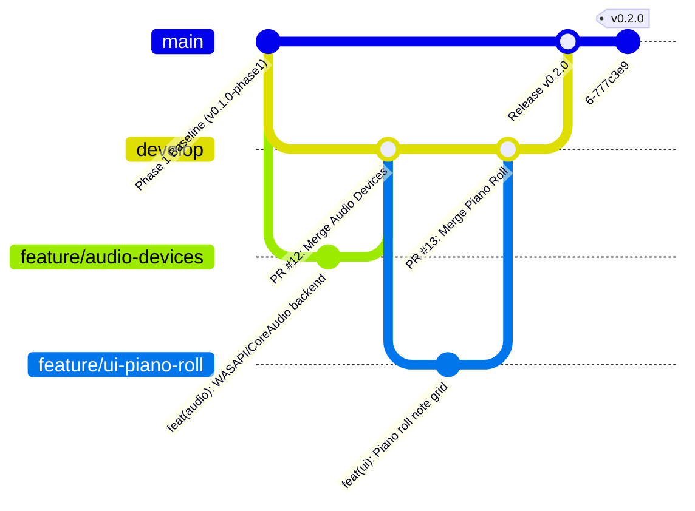

# Contributing to ARCLINE

> **Product:** ARCLINE Desktop Digital Audio Workstation  
> **Tagline:** "Shape Your Sound."  
> **Architecture:** C++20 | JUCE 8.0.6 | CMake 3.22+ | Ninja  
> **Target Platforms:** Windows 10/11 x64, macOS (Apple Silicon & Intel), Ubuntu/Debian Linux, Arch Linux  
> **Document:** Contributor Workflow & Engineering Governance  

Thank you for contributing to ARCLINE. ARCLINE is a native desktop Digital Audio Workstation engineered with the visual language, editing density, and ergonomic conventions of Apple Logic Pro X.

To enable dozens of software engineers and AI coding agents to build UI screens, real-time audio subsystems, MIDI engines, VST3 hosting, and cross-platform packaging simultaneously without stepping on each other, ARCLINE strictly enforces the workflow, branching model, and interface boundaries described in this guide.

---

## 1. Quick Onboarding Checklist

Before writing any code, every human developer and AI coding agent **must** execute this sequence:

1. **Read Core Architecture:** Review [`README.md`](file:///e:/SonaraDaw/README.md), [`docs/ARCHITECTURE.md`](file:///e:/SonaraDaw/docs/ARCHITECTURE.md), and [`docs/DAW_ENGINE_ARCHITECTURE.md`](file:///e:/SonaraDaw/docs/DAW_ENGINE_ARCHITECTURE.md).
2. **Review Command Boundary:** Read [`docs/INPUT_COMMAND_BOUNDARY.md`](file:///e:/SonaraDaw/docs/INPUT_COMMAND_BOUNDARY.md) to understand how user gestures dispatch to actions.
3. **Inspect the Task Catalog:** Open [`docs/CONTRIBUTOR_TASKS.md`](file:///e:/SonaraDaw/docs/CONTRIBUTOR_TASKS.md) to identify an `AVAILABLE` task.
4. **Claim Your Task:** File or comment on an issue titled `[CLAIM] <Task ID>: <Title>` before writing any code.
5. **Branch Off `develop`:** Create your designated feature branch exclusively off the latest `develop` commit.
6. **Preserve Boundaries:** Edit only the files permitted by your task's scope.
7. **Test & Verify:** Run all unit and integration tests locally before opening a Pull Request.

---

## 2. Git Branching Model & Taxonomy

The ARCLINE repository uses an isolated Git branching model:



### Permanent Branches

| Branch | Description | Direct Pushes Allowed? |
| :--- | :--- | :--- |
| **`main`** | Production-ready, verified release code only. Every commit corresponds to an official release tag. | **NEVER** (Protected) |
| **`develop`** | Active integration branch. All reviewed feature pull requests merge here. | **NEVER** (Protected — PR only) |
| **`phase-1-frozen`** | Permanent historical archive of the verified Phase 1 desktop foundation (`v0.1.0-phase1`). | **NEVER** (Frozen baseline) |

### Branch Naming Conventions

All topic branches must use one of the following prefixes:

| Branch Pattern | Purpose | Starting Point | Target Branch |
| :--- | :--- | :--- | :--- |
| `feature/<name>` | New user-facing or architectural functionality | `develop` | `develop` |
| `fix/<name>` | Bug fix addressing a confirmed defect | `develop` (or `main` for hotfix) | `develop` |
| `refactor/<name>` | Structural or internal refactoring with zero behavior change | `develop` | `develop` |
| `test/<name>` | Dedicated test suites, benchmarks, or mock frameworks | `develop` | `develop` |
| `docs/<name>` | Documentation, architectural ADRs, or workflow guides | `develop` | `develop` |
| `build/<name>` | CMake, CI scripts, packaging manifests, or toolchains | `develop` | `develop` |

> [!CAUTION]
> **Prohibited Actions:** Never force-push (`git push --force`) to `main`, `develop`, or any shared team branch. Never delete or reset shared branches. Never commit binary build outputs (`build/`, `*.exe`, `*.obj`) to Git.

---

## 3. Feature Categories Catalog

When creating a feature branch, select a standardized name from the category catalog:

### A. UI Foundation
- `feature/ui-shell` — Desktop window, multi-workspace routing, docking layout.
- `feature/ui-components` — Reusable dark controls, faders, knobs, meters, LCD panels.
- `feature/ui-theme` — Logic Pro X graphite look-and-feel, color tokens, typography.
- `feature/ui-start-project` — Start Studio project chooser, template picker, recent files.
- `feature/ui-preferences` — Global audio, theme, autosave, and keyboard preferences dialog.
- `feature/ui-command-palette` — Fast fuzzy-search command overlay (`Ctrl+K`).

### B. Arrangement & Editing UI
- `feature/ui-arrangement` — Multitrack arrangement workspace, timeline lanes, scissors.
- `feature/ui-audio-editor` — Sample waveform audio editor lower panel.
- `feature/ui-piano-roll` — MIDI piano roll editor, note grid, velocity lane.
- `feature/ui-step-sequencer` — Pattern step sequencer lower panel.
- `feature/ui-automation` — Automation curve overlay and breakpoint editing.
- `feature/ui-browser` — Sound preset library and filesystem asset browser.
- `feature/ui-export` — Offline bounce / stem export dialog.

### C. Audio Engine
- `feature/audio-engine` — Master real-time processing callback, block scheduler, xrun telemetry.
- `feature/audio-devices` — Hardware audio driver backends (WASAPI, ASIO, CoreAudio, ALSA, JACK).
- `feature/audio-transport` — Sample-accurate transport clock, musical timebase, cycle loop.
- `feature/audio-dsp` — Internal DSP primitives (biquad filters, circular buffers, peak hold).
- `feature/audio-diagnostics` — Real-time telemetry, CPU load measurement, drop detection.

### D. Project & Session Management
- `feature/project-format` — Durable `.arcline` JSON Schema v2, atomic persistence.
- `feature/track-model` — Domain `Track` model, mute, solo, arm, routing state.
- `feature/region-model` — Domain `Region` model, audio peaks, MIDI note vectors.
- `feature/project-recovery` — Background autosave snapshots and crash recovery journal.
- `feature/undo-redo` — Reversible transaction history (`UndoHistory`).
- `feature/media-management` — Relative audio file referencing and asset consolidation.

### E. MIDI & Instruments
- `feature/midi-engine` — Hardware MIDI In/Out discovery, lock-free event queues.
- `feature/midi-recording` — Real-time MIDI message capture into timeline regions.
- `feature/midi-instruments` — Native software instruments (subtractive synth).
- `feature/sampler` — Polyphonic multi-sample playback engine.
- `feature/midi-routing` — Channel routing, transposition, MIDI filtering.

### F. VST3 & Plugin Hosting
- `feature/vst3-host` — Native VST3 plugin instantiation, audio/MIDI processing, state chunks.
- `feature/plugin-scanner` — Isolated out-of-process plugin discovery scanner.
- `feature/plugin-state` — Preset recall, preset browser, state persistence in `.arcline`.
- `feature/plugin-editor` — Native plugin UI window embedding and event bridging.
- `feature/plugin-compatibility` — VST3 standard compliance and sandboxing fallbacks.

### G. Mixer & Audio Routing
- `feature/mixer-engine` — Topological audio graph, summing engine, de-zippered faders.
- `feature/ui-mixer` — Channel strip console dock, bus grouping, panning.
- `feature/audio-routing` — Aux sends, sidechain routing, sub-mix summing.
- `feature/audio-effects` — Native EQ, compressor, delay, reverb channel plugins.
- `feature/plugin-automation` — Sample-accurate parameter automation playback.
- `feature/latency-compensation` — Plugin delay compensation (PDC) graph resolver.

### H. Cross-Platform & Release Engineering
- `feature/platform-windows` — WASAPI/ASIO, Windows shell associations, installer (`.iss`).
- `feature/platform-macos` — CoreAudio, CoreMIDI, Apple Silicon universal binary, DMG packaging.
- `feature/platform-linux` — ALSA, PipeWire, JACK, Wayland/X11 rendering, `.deb` & `.AppImage`.
- `build/cmake` — CMake modern target refactoring, presets, compiler warning flags.
- `build/ci` — GitHub Actions multi-platform build and automated test matrix.
- `build/linux-packaging` — Debian control files and portable Linux manifests.
- `build/windows-packaging` — Inno Setup packaging scripts and signing.
- `build/macos-packaging` — macOS notarization scripts and bundle builders.

### I. Quality Assurance
- `test/audio-engine` — Headless audio rendering tests, zero-allocation verifiers.
- `test/project-system` — Project serialization durability and corruption recovery tests.
- `test/ui-regression` — Visual screenshot diffing and layout assertion tests.
- `test/plugin-host` — Third-party plugin stress tests and fuzz testing.
- `test/platform-compatibility` — Cross-OS regression test suite.

---

## 4. Strict Interface Contracts & Anti-Contamination Rules

To prevent code bloat, tight coupling, and broken multi-platform builds, all contributions must respect the following architectural invariants:

### 1. UI Layer Boundary
- **Rule:** UI components (`src/ui/*`) must NEVER access real-time audio threads, raw audio sample pointers, or low-level driver sockets.
- **Mechanism:** UI triggers actions exclusively via `sonora::core::CommandRegistry` or `sonora::app::AppContext`.
- **Observable State:** UI components observe state changes via `ProjectListener` callbacks or lock-free polling timers (e.g. meters at 60 FPS).
- **Prohibition:** Never modify an audio DSP callback simply to make a button respond in the UI!

### 2. Real-Time Audio Engine Boundary
- **Rule:** The audio rendering callback is a **hard real-time thread**.
- **Invariants:**
  1. **Zero dynamic memory allocation:** No `new`, `malloc`, `std::vector::push_back`, or string formatting inside `processBlock()`.
  2. **Zero blocking primitives:** No `std::mutex`, `juce::CriticalSection`, file I/O, or OS syscalls on the audio thread.
  3. **Lock-free communication:** Use atomic variables (`std::atomic<float>`) and lock-free ringbuffers (`juce::AbstractFifo`) to communicate with the UI thread.

### 3. Project Persistence Boundary
- **Rule:** Project saving and loading (`src/infrastructure/ProjectRepository.*`) owns serialized `.arcline` files.
- **Atomicity:** All file writes must be atomic (write to `.tmp` file and rename upon completion) to ensure data cannot be corrupted during an unexpected crash or power cut.

### 4. Transport Controller Boundary
- **Rule:** Transport state (Play, Stop, Cycle, Sample Position) is owned by `ITransportController`.
- **Communication:** Transport commands are queued from the UI/Command layer into an atomic ringbuffer consumed by the audio engine at sample boundaries.

---

## 5. Preventing Merge Conflicts: Ownership of Central Files

Certain files in the repository are shared across multiple domains. To avoid merge contention:

| Central File | Designated Owner | Protocol for Modification |
| :--- | :--- | :--- |
| `CMakeLists.txt` | Build / Release Team (`build/*`) | Submit an isolated PR for build changes; do not bundle CMake edits with UI features. |
| `src/app/AppContext.h` | Architecture Leads | Open an **Interface Contract RFC** issue before adding new shared application services. |
| `src/core/CoreDefines.h` | Architecture Leads | Changes to shared constants require core review. |
| `src/ui/theme/SonoraTheme.h` | UI Foundation Team (`feature/ui-theme`) | Theme color tokens must be updated in a dedicated PR. |
| `src/infrastructure/ProjectRepository.cpp` | Project Format Team (`feature/project-format`) | Changes to JSON schema must increment schema version number. |

---

## 6. How to Choose a Task (Step-by-Step)

Follow this 12-step sequence whenever you or an AI agent start work:

```
[1. Read README & Docs] ──> [2. Open CONTRIBUTOR_TASKS.md] ──> [3. Identify AVAILABLE Task]
                                                                        │
                                                                        ▼
[6. Work in Local Branch] <── [5. Create feature/* Branch] <── [4. File Claim Issue]
           │
           ▼
[7. Implement within Scope] ──> [8. Run ArclineTests.exe] ──> [9. Capture Evidence]
                                                                        │
                                                                        ▼
[12. Merge & Complete] <── [11. Pass CI & Code Review] <── [10. Submit PR with Template]
```

1. **Inspect Repo:** Confirm clean working tree (`git status`).
2. **Review Catalog:** Open [`docs/CONTRIBUTOR_TASKS.md`](file:///e:/SonaraDaw/docs/CONTRIBUTOR_TASKS.md).
3. **Verify Dependencies:** Verify all tasks listed under **Dependencies** have `COMPLETED` status.
4. **Claim Task:** Open a GitHub Issue using the Task Claim template.
5. **Update Status:** In your branch, update the task status in `docs/CONTRIBUTOR_TASKS.md` to `IN PROGRESS` with your name.
6. **Create Branch:**
   ```powershell
   git checkout develop
   git pull origin develop
   git checkout -b <Git Branch Name from Catalog>
   ```
7. **Implement:** Write clean, modular C++20 code strictly within the **Files Expected to Change**.
8. **Preserve Integrity:** Preserve all existing comments and documentation.
9. **Build Locally:**
   ```powershell
   cmake --build build --config Release
   ```
10. **Test Locally:**
    ```powershell
    .\build\bin\ArclineTests.exe
    ```
11. **Capture Evidence:** Take screenshots for UI tasks; document signal tests for audio tasks.
12. **Submit PR:** Submit a Pull Request targeting `develop` using the `.github/pull_request_template.md`.

---

## 7. Pull Request Standards & Quality Bar

Every Pull Request submitted to ARCLINE will be evaluated against this quality bar. Pull requests that claim functionality without implementing it or that report tests without executing them will be rejected.

Each PR description must fill out all 9 required sections in [`.github/pull_request_template.md`](file:///e:/SonaraDaw/.github/pull_request_template.md):

1. **Summary:** Clear explanation of what was implemented and why.
2. **Task ID & Branch:** Catalog Task ID (e.g. `AUD-001`) and Git branch name.
3. **Scope & Exclusions:** What was changed and what was deliberately excluded.
4. **Files Changed:** Key source, test, and documentation files modified.
5. **Verification & Exact Commands:** Exact shell commands executed and test pass output.
6. **Visual Evidence:** Embedded PNG/WebP screenshots for UI changes.
7. **Audio Evidence:** Loopback signal verification, zero-allocation assertions, or DSP telemetry for audio changes.
8. **Platform Status Matrix:** Verification status across Windows, macOS, Ubuntu, and Arch.
9. **Known Limitations:** Any deferred edge cases or follow-up tasks.

---

## 8. Automated Merge Gates & CI Pipeline

All Pull Requests targeting `develop` or `main` must pass the automated GitHub Actions CI pipeline:

1. **Configuration Gate:** Clean CMake configuration with `-DARCLINE_BUILD_TESTS=ON`.
2. **Compilation Gate:** Zero compiler errors and zero compiler warnings on MSVC, Clang, and GCC.
3. **Automated Test Gate:** 100% pass rate on `ctest` across all test suites.
4. **Durability Gate:** Atomic saving, corruption rejection, and schema validation tests pass.
5. **Review Gate:** At least one core maintainer approval.

---

## 9. Git Command Cheat Sheet for Contributors

### Synchronize with `develop`
```powershell
# Fetch latest commits from remote
git fetch origin

# Switch to develop and update
git checkout develop
git pull origin develop
```

### Start a New Task
```powershell
git checkout develop
git checkout -b feature/audio-devices
```

### Keep Your Feature Branch Up to Date
```powershell
# Rebase your feature branch on the latest develop
git checkout feature/audio-devices
git fetch origin
git rebase origin/develop
```

### Run Build & Tests
```powershell
# Compile the native Release build
cmake --build build --config Release

# Run the test suite
.\build\bin\ArclineTests.exe
```

---

*ARCLINE — Shape Your Sound.*
